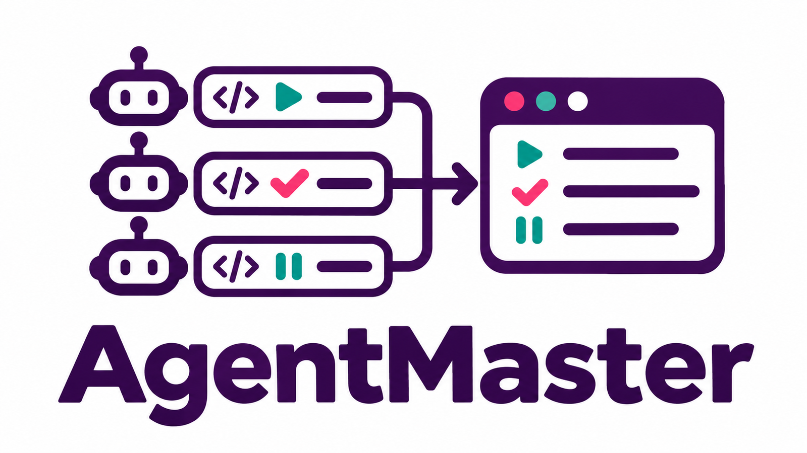

<p align="center">
  
</p>

# agentmaster

**TUI command center for Claude Code, Codex, tmux and cmux agent fleets.**
agentmaster lets one human see and steer many coding agents from one terminal:
real-time status, human-readable task titles, transcript peeks, desktop alerts,
and zero orchestration tax.


[🚀 Install](#install) · [▶️ Quick start](#quick-start) · [⌨️ Keys](#keys) · [🤖 CLI](#cli) · [🏗️ Architecture](#architecture)

## Why

Most multi-agent setups spend tokens asking an LLM orchestrator what is running,
blocked, done, or waiting. agentmaster removes that cost:

- **Observed state:** status is inferred from terminal output and cmux/tmux state.
- **Human routing:** the list floats `NEED YOU` work to the top.
- **On-disk coordination:** SQLite audit log, goals, seen-state and events.
- **Zero-token peeks:** transcript reads show last user, last assistant and next action.

## Highlights

- Dense list + detail view that scales to large fleets.
- Real cmux/tmux discovery on boot, plus native PTY agents.
- Live status updates from `cmux events` with polling as a backstop.
- Desktop notifications for `blocked` and `done` transitions (`N` toggles).
- Human task labels: noisy titles like `</task-notification>` are replaced with
  the transcript's first real prompt.
- `H` hide-noise mode removes stale idle rows and non-agent shell tabs.
- Ground-truth last-response ages from transcript mtimes where available.
- `focus`, `send`, `broadcast`, `goal`, `peek`, `ls --json` and session-restore
  helpers for headless workflows.
- Hash-verified local prompt artifacts: discover, inspect, render `{{variables}}`,
  and send only through an explicit existing control target.

## Install

```bash
git clone https://github.com/Supersynergy/agentmaster.git
cd agentmaster
cargo build --release
./target/release/agentmaster --version
```

Optional local install:

```bash
install -m 0755 target/release/agentmaster ~/.local/bin/agentmaster
agentmaster doctor
```

Requires Rust 1.95+. macOS and Linux are the target environments.

## Quick Start

```bash
agentmaster doctor          # check data dir, PTY, runtimes, tmux/cmux
agentmaster                 # launch the TUI
agentmaster ls --json       # native TUI PTYs + discovered tmux/cmux agents
agentmaster status --json   # fleet, backend reachability, runtimes, adapters, goals
agentmaster peek <id>       # read transcript last-user/assistant/next
agentmaster peek native:7 --tail 20  # bounded observed terminal output from a live TUI
```

Inside the TUI, press `d` to discover again, `S` to cycle sort, `/` to filter,
`H` to hide noise, `f` to jump to the real cmux/tmux tab, and `?` for help.

## CLI

```bash
# See
agentmaster ls [--json]
agentmaster goals [--json]
agentmaster events -n 100
agentmaster peek <session-id>

# Steer
agentmaster send workspace:96 run the tests
agentmaster send dev:1.0 cargo nextest run
agentmaster broadcast "status?" --needs-input
agentmaster focus workspace:96
agentmaster interrupt workspace:96  # Ctrl-C; preserves the workspace/transcript
agentmaster send native:7 "run the focused test"
agentmaster focus native:7           # select that PTY in the running TUI

# Explicit bridges to the existing local control CLIs
agentmaster control sycadapter --help
agentmaster control sycadapter --model gpt-6-luna  # foreground loopback HTTP server
agentmaster control sycadapter rpc                # native SynergyCoder stdio
agentmaster control llmadapter lanes
agentmaster control cmux list-workspaces
agentmaster control hermes --help

# Local prompt artifacts are data, never commands to execute
agentmaster prompts discover --root /Users/master/Downloads --modified-on 2026-08-01
agentmaster prompts doctor --json
agentmaster prompts list
agentmaster prompts search --json "red team"
agentmaster prompts show prompt-libraries-top50-2026-07-31 --json
agentmaster prompts render safe-template --var name=world
agentmaster prompts send safe-template native:7 --var name=world --dry-run
agentmaster prompts links doctor --json
agentmaster prompts links search "prompt evaluation"
agentmaster prompts links show promptfoo --json

# Start a Codex worker with an explicit model
agentmaster assign codex --model gpt-6-luna --name luna-audit "read-only audit"

# Goals and fan-out
agentmaster goal payments-api ship checkout :: all e2e tests green
agentmaster batch tasks.md --yes
```

`prompts discover` writes `/Users/master/.agentmaster/prompt-catalog.json` with
canonical absolute paths and SHA-256 hashes. `search`, `show`, `render`, and
`send` re-check the selected artifact before reading it. Rendering only replaces
explicit `{{key}}` placeholders; it does not evaluate prompt text. Sending needs
an explicit agent reference and reuses the existing native/cmux/tmux transport.
Use `--dry-run` before a real delivery.

`prompts links` exposes the curated external libraries and tools cited by the
registered Top-50 source report. The bundled registry only includes reusable
prompt/skill libraries, system-prompt references, prompt tooling, and explicitly
labelled security research. Every URL must occur in the hash-pinned local report.
Links are references only. AgentMaster never clones, installs, executes, or sends
remote source material automatically.

## Lean llmadapter ensembles

<details>
<summary>Read the background and detailed guidance</summary>

`ensemble` is an opt-in bridge for a small llmadapter swarm. AgentMaster stays
the controller: it gives every lane the same bounded task, saves each answer as
a private artifact, runs your oracle against answers one by one, and stops at
the first PASS. It does not aggregate, self-verify, or claim provider cost.
`llmadapter` must be executable on `PATH` and advertise the v2 capability
contract (`schema_version = 2`, `ask_v2`, at most three workers, at most 500
result tokens, at most 1,800 prompt bytes). AgentMaster probes it before both
dry-run and execution. Older adapters fail closed; there is no v1 fallback.

Start with a dry-run. Local lanes are the default:

```bash
agentmaster ensemble answer-check \
  --oracle 'grep -qi sqlite "$AGENTMASTER_ANSWER_PATH"' \
  --dry-run \
  "Name AgentMaster's embedded database in one line"
```

Execute only after checking that plan:

```bash
agentmaster ensemble answer-check \
  --oracle 'grep -qi sqlite "$AGENTMASTER_ANSWER_PATH"' \
  --go \
  "Name AgentMaster's embedded database in one line"
```

Answers and usage stay under
`~/.agentmaster/ensembles/<name>/<run-id>/` with private permissions. The task
is fed to `llmadapter ask-v2 --stdin` through an immediately unlinked private
regular file, so it is absent from child argv and durable controller artifacts.
The raw adapter JSON is not persisted; a model answer can still quote its input.
A private `manifest.json` records only task and answer hashes, task byte count,
v2 capability, lane cap evidence, byte/deadline bounds, timings, oracle exit
status, artifact names, and final status. SQLite receives only status, SHA-256
fingerprints, and artifact paths.

`--max-tokens` accepts at most 500, but it is a requested output ceiling:
provider enforcement varies, especially for Ollama and CLI lanes. This is not a
hard token or cost budget. Independently, nonblocking pipes retain at most the
configured stdout/stderr bytes and kill the process group on overflow without
restricting unrelated child artifacts. The adapter JSON ceiling is 1 MiB and
the wall deadline defaults to 120 seconds. `--fresh` disables the cache.

Before any oracle runs, AgentMaster requires a v2 result envelope whose prompt
hash and byte count match stdin, whose worker counts respect the advertised cap,
and whose embedded accounting exactly matches a private, complete v2 usage
artifact. It recomputes calls, cache hits, and token coverage from strict lane
records; rejected usage is deleted and accepted usage is rewritten canonically.
Structured nonzero results remain failure evidence but never reach
the oracle. `ATS_PII_SHIELD=1` and `--no-cache` are forced for remote lanes.

Remote selectors (`free`, `cli`) need `--allow-remote`. `paid` needs both
`--allow-remote` and `--allow-paid`. Named lanes and `all` require both flags
because the capability probe does not classify an arbitrary named lane:

```bash
agentmaster ensemble compare \
  --lanes free --allow-remote --fresh \
  --oracle './scripts/check-answer "$AGENTMASTER_ANSWER_PATH"' \
  --go \
  propose the smallest compatible patch
```

The oracle receives `AGENTMASTER_RUN_DIR`, `AGENTMASTER_ANSWER_PATH`, and
`AGENTMASTER_USAGE_PATH`. Its exit code is the decision: zero is PASS.

`--first-pass` starts every lane at once and hands the same oracle down to the
adapter, so the first PASS prunes its peers while they are still generating.
The oracle string keeps working unchanged: agentmaster also passes
`--oracle-env-prefix AGENTMASTER`, so `AGENTMASTER_ANSWER_PATH` is defined on
both sides. If the controller passes while the adapter found no winner, the run
says so — that combination means nothing was pruned and the run cost full price.

```bash
agentmaster ensemble answer-check \
  --oracle 'grep -qi sqlite "$AGENTMASTER_ANSWER_PATH"' \
  --first-pass --budget-tokens 4000 --go \
  "Name AgentMaster's embedded database in one line"
```

`--budget-tokens` is a hard per-lane ceiling enforced inside the adapter, unlike
`--max-tokens` which only requests one. `--evidence` gathers one primary-source
artifact before the lanes start and puts it in every capsule. `--skill-route`
lets the adapter's router name one skill.

## Route: reuse a warm agent instead of cold-starting one

`assign` always spawns a fresh workspace. That discards the repo context the
agent already read and the provider's prompt cache for that conversation prefix,
which holds for roughly five minutes. `route` ranks the live fleet instead:

```bash
agentmaster route "continue the payment retry work"     # rank + print the send command
agentmaster route --send "continue the payment retry work"
agentmaster route --or-assign claude "…"                # reuse if warm, else cold-start
```

Ranking uses only observed state — working directory, title, cmux status and
transcript mtime — so it costs no tokens and is unit-tested. Candidates inside
the cache window are marked `warm`. Busy agents are skipped unless
`--include-busy`, because sending to a working agent trades its context for
yours, and this session is excluded via its own parent-pid chain so `route` can
never hand the task back to itself. Below `--min-score` it recommends a cold
start rather than forcing a bad reuse.

## Research: gather once, reference N times

A fleet that needs the same fresh fact usually pays for it once per worker, and
drags the raw page through every transcript. `research` does the lookup once, on
the controller side, and hands workers a path:

```bash
agentmaster research pricing --code --trends "vector database pricing 2026"
```

Research is cache-first. An identical request inside `--ttl-secs` (default 24h)
runs no source at all and re-reports the previous run; `--refresh` bypasses it
and reaches the provider rather than its cache. The key covers query, mode, byte
budget and the chosen sources — not the run name, since the same query gathered
under two names is the same fetch. `--dry-run` prints the key and whether it
would hit. `--primary` additionally asks the primary-source registry, so a
version, price or policy claim can cite whoever owns the fact.

Hand the result to a fleet instead of paying each lane to gather it again:

```bash
agentmaster swarm pricing --oracle './check.sh' --research pricing "update the pricing page"
```

`--evidence-file PATH` does the same with an explicit artifact. Every lane's
capsule gets the same path, the reference carries its own capsule budget so the
task never shrinks, and a path that does not exist is refused rather than
handed to a worker who would then invent the fact.

Artifacts land under `~/.agentmaster/research/<name>/<run>/` with `0600`
permissions, and the command prints a capsule line you can paste into a swarm or
an `assign`. Gathering spends **zero model tokens** — the web source is
`llmadapter evidence`, which caches, projects and reports without running a
lane. `--code` adds a bounded `ghmax` search, `--trends` a bounded
`superweb gitstars` scan. Every source is detected rather than installed, is
killed at `--deadline-secs`, and streams its stdout straight into its artifact
file, so a large page never passes through agentmaster's memory. Use `--dry-run`
to see which sources would run and where they resolve on `PATH`.

Reproducible zero-provider proof: the
[llmadapter payload benchmark](docs/LLMADAPTER-BENCHMARK.md) reduces a
constructed 4,000-line log payload from 184,497 to 852 bytes (99.5382%) after
local projection while preserving the executable oracle inputs. This is a
payload-capacity case study, not a provider-token, cost, quality, or end-to-end
latency claim.


</details>

## Keys

| Key | Action |
|-----|--------|
| `1` `2` `3` `4` | list / board / tree / logs |
| `j` `k` | move selection |
| `h` `l` | page in list or move lanes on board |
| `S` | cycle sort |
| `H` | hide stale/non-agent noise |
| `/` | filter by title, task label, last line or goal |
| `Enter` | inspect selected agent |
| `f` | jump to the real cmux/tmux tab |
| `s` | send a line |
| `g` | set goal + optional definition of done |
| `p` | refresh transcript peek |
| `N` | desktop notifications on/off |
| `d` | discover tmux panes + cmux workspaces |
| `q` | quit |

## Architecture

agentmaster is one Rust binary. Render is a pure function of application state;
mutation stays in `src/app.rs`.

```text
src/main.rs      CLI entry
src/app.rs       event loop, state transitions, cmux/tmux orchestration
src/ui.rs        ratatui rendering
src/fleet.rs     Agent, Status, Lane, Fleet
src/backend.rs   tmux + cmux adapters
src/peek.rs      transcript resolution + zero-token digest
src/store.rs     SQLite audit log, goals, seen-state
src/state.rs     output -> status/progress heuristics
src/pty.rs       native PTY backend
src/prompts.rs   hash-verified prompt artifact catalog and safe delivery
```

Docs:

- [SPEC](docs/SPEC.md)
- [Architecture ADR](docs/adr/0001-architecture.md)
- [TUI Best Practices ADR](docs/adr/0002-tui-best-practices.md)
- [Competitive Audit](docs/COMPETITIVE-AUDIT.md)
- [Changelog](CHANGELOG.md)

## Development

```bash
just setup
just check      # fmt check + clippy -D warnings + build
just ci         # doctor + check + tests + release build
```

Release gate used for v0.17.0:

```bash
cargo fmt --check
cargo nextest run
cargo clippy --all-targets --all-features -- -D warnings
cargo build --release
```

## License

MIT. See [LICENSE](LICENSE).
